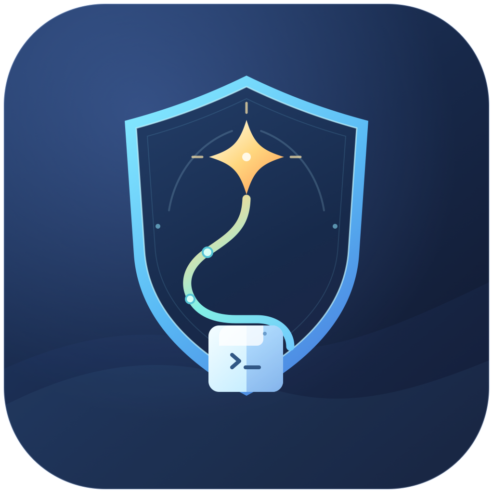

<p align="center">
  
</p>

<h1 align="center">Chaperone</h1>

<p align="center">Run a script as the responsible process of a tiny background app, so macOS Developer Tools exempts what it builds from the XProtect first-launch scan.</p>

Chaperone is a tiny macOS app that runs one script as its *responsible process*. Add it to **System Settings > Privacy & Security > Developer Tools**, and every program the script builds and starts skips the XProtect first-launch scan. It has no window, no Dock icon and never shows a prompt.

It was written for a compiler's test gate. The gate builds and starts thousands of fresh binaries, and each first launch from an agent's shell cost 38–39 s of scanning. Through an exempt app the same launch takes 0.010 s.

## The problem

On every first launch of a newly built, unnotarized program, `syspolicyd` queues an XProtect scan. The scan is skipped when the program's **responsible process** is an app listed (and switched on) under Developer Tools. `tccd` makes that check: it is asked for `kTCCServiceDeveloperTool` on behalf of the responsible process.

The responsible process is usually the app that started the chain: a terminal, an IDE. A child inherits it from its parent unless someone *disclaims* responsibility while spawning it. This is where the exemption gets lost:

- **Agent tools and wrappers.** Claude Code's Bash tool breaks the chain: its children lose the host app's exemption ([anthropics/claude-code#104173](https://github.com/anthropics/claude-code/issues/104173)).
- **Terminal multiplexers and session servers.** Sessions run under a daemon launched by `launchd`, so the daemon is the responsible process, not the terminal app you see. If that daemon is not an app, or its Developer Tools entry has gone stale, you pay the scan.
- **`osascript`, `nohup`, `setsid`, detached shells.** None of them starts a new responsible process. They stay in the caller's chain.

Only an app that **LaunchServices** starts (`open -a …`) becomes a fresh responsible process. The [cargo-nextest macOS notes](https://nexte.st/docs/installation/macos/) describe the same mechanism and the usual fix: list your terminal. That works until the chain passes through something that disclaims it, or you don't want a terminal window for a 3-hour background run.

Chaperone is that app, made for the job: `open` starts it, it spawns your script without disclaiming responsibility, waits, writes the exit status and quits. The Developer Tools picker accepts only `.app` bundles, so it is an app. A small command-line shim, `chaperone`, calls `open` for you.

## Install

Chaperone needs macOS 13 or later on Apple silicon. Pick one of four ways. The first two and the last build it on your Mac from source, which needs the Xcode command-line tools (`xcode-select --install`). Building it yourself is the safer choice for a tool that skips malware scans: the source is one Swift file you can read first.

| Way | Command | The app to add to Developer Tools |
|---|---|---|
| Homebrew | `brew install dedalozzo/chaperone/chaperone` | `/opt/homebrew/opt/chaperone/Chaperone.app` |
| MacPorts | `sudo port install chaperone` | `/Applications/MacPorts/Chaperone.app` |
| Release zip | see below | `~/Applications/Chaperone.app` |
| From source | `make install` | `~/Applications/Chaperone.app` |

### Homebrew

```sh
brew install dedalozzo/chaperone/chaperone
```

The formula lives in the tap [dedalozzo/homebrew-chaperone](https://github.com/dedalozzo/homebrew-chaperone). It builds the app into the Homebrew prefix and links `chaperone` into Homebrew's `bin`.

### MacPorts

```sh
sudo port install chaperone
```

Until the port is in the MacPorts tree, use the Portfile in `packaging/macports/` as a local port repository (see `packaging/macports/README.md`). The app goes to `/Applications/MacPorts/Chaperone.app` and the shim to `/opt/local/bin/chaperone`.

### Release zip

Each [GitHub release](https://github.com/dedalozzo/chaperone/releases) has a ready-built `Chaperone-<version>-arm64.zip`. The app in it is signed only ad hoc, not by an Apple developer certificate, so macOS quarantines the download and refuses to open it. Clear the quarantine flag yourself, and only if you trust the build:

```sh
cd ~/Downloads
ditto -x -k Chaperone-1.0.0-arm64.zip .
xattr -dr com.apple.quarantine Chaperone-1.0.0
mkdir -p ~/Applications ~/.local/bin
ditto Chaperone-1.0.0/Chaperone.app ~/Applications/Chaperone.app
install -m 755 Chaperone-1.0.0/chaperone ~/.local/bin/chaperone
```

The release page lists the zip's SHA-256. Check it with `shasum -a 256 Chaperone-1.0.0-arm64.zip` before installing.

### From source

```sh
make install
```

This builds `build/Chaperone.app` (ad-hoc signed) and copies it to `~/Applications/Chaperone.app`, and the shim to `~/.local/bin/chaperone`. No sudo. `PREFIX_APP`, `PREFIX_BIN`, `APP_PATH` and `DESTDIR` change where things go (see the `Makefile`).

### Then, by hand, once

1. Open **System Settings > Privacy & Security > Developer Tools**.
2. Click **+**, pick the app from the table above (press ⇧⌘G in the picker and type the path), and make sure its switch is on.

Then create the allowlist (below). Chaperone refuses everything until it exists.

### Ad-hoc signing: re-add after every rebuild

There is no signing identity in v1: the app is signed ad hoc, so its identity is its code hash, which changes on every rebuild. **After every rebuild, upgrade or reinstall (`make install`, `brew upgrade`, `port upgrade`, a new release), remove Chaperone from Developer Tools and add it again.** Otherwise the old entry no longer matches and every launch is scanned again. Signing with a stable identity (a self-signed certificate, or a free Apple Development certificate) would remove this step.

The bundle identifier is `io.github.dedalozzo.chaperone`. Don't change it.

The first launch of a freshly built Chaperone.app is itself scanned (about 40–50 s here), because nothing exempts the app's own launch. Later launches start at once.

## Usage

```sh
chaperone [--wait] [--clean-env] [--cwd DIR] [--log FILE] [--status FILE] -- /abs/script [args...]
```

| Option | Meaning |
|---|---|
| `--wait` | Block until the script ends, then exit with its exit code: 128+N if signal N ended it, 126 if Chaperone refused the script, 125 if Chaperone itself failed. |
| `--clean-env` | Don't pass the caller's environment: the script gets LaunchServices' base environment plus `HOME`, `USER`, `LOGNAME`, `TMPDIR` and `PATH=/usr/bin:/bin:/usr/sbin:/sbin`. By default, every exported variable is handed over with one `open --env K=V` each. (On macOS 26.5, `open` also passes its own environment to the app it launches, so `--clean-env` runs `open` under `env -i`.) |
| `--cwd DIR` | The script's working directory. Default: the caller's `$PWD`. |
| `--log FILE` | The script's stdout and stderr are appended here. Default: `$TMPDIR/chaperone-<timestamp>.log`. |
| `--status FILE` | The status file. Default: `$TMPDIR/chaperone-<timestamp>.status`. |

The shim prints `log=<path>` and `status=<path>` on stdout. The script's stdin is `/dev/null`.

The status file gets one line per event:

```
app=<pid of the Chaperone instance>
pid=<pid of the script>
exit=<code>          or   signal=<n>
```

A refusal writes `refused=<reason>` followed by `exit=126`. Refusals also go to the unified log:

```sh
/usr/bin/log show --last 1h --predicate 'subsystem == "io.github.dedalozzo.chaperone"'
```

(In zsh, a bare `log` is a builtin: use `/usr/bin/log`.)

Each `chaperone` call starts a separate Chaperone instance (`open -n`), so runs can overlap. Without `--wait` the shim returns at once and the run carries on: it does not depend on the shell that started it. With `--wait` you can still run the shim detached (e.g. in the background of an agent session) and collect the exit code when it ends. Killing the shim never stops the run.

To stop a run, send SIGTERM (or SIGINT, SIGHUP) to the `app=` pid. Chaperone forwards it to the script's process group, then records `signal=<n>`.

The script must be executable and start with a `#!` line. A typical gate script:

```sh
#!/bin/zsh
export LC_ALL=C
cd /abs/path/to/checkout/compiler || exit 1
exec ./ci-check.sh
```

```sh
chaperone --wait --cwd /abs/path/to/checkout -- /abs/path/to/gate-scripts/run-gate.sh
```

## The allowlist

`~/.config/chaperone/allow` lists one absolute path prefix per line. Blank lines and `#` comments are ignored. A missing file means every script is refused.

```
# Chaperone: scripts it may run
/Users/me/tools/gate-scripts
```

Chaperone runs a script only if all of these hold:

- the script's real path (symlinks resolved) is a listed prefix or lies under one (`/a/b` allows `/a/b/x.sh`, not `/a/bc/x.sh`); a prefix of `/` is ignored;
- the script is a regular, executable file owned by you, and neither group- nor world-writable;
- the allowlist file itself is owned by you and neither group- nor world-writable.

The allowlist is read from your home directory as the user database records it, not from `$HOME`, so a caller's environment can't move it.

## Security note

Listing an app under Developer Tools tells macOS not to malware-scan what that app runs. Chaperone extends that to **every script the allowlist permits, and everything those scripts start**. Keep the allowlist narrow:

- List a directory of scripts you wrote and that only you can change, not a whole checkout, `~`, or a downloads folder.
- Anything that can run as you can already call `chaperone`, so the allowlist is what stands between "runs as you" and "runs as you, unscanned".
- The caller's environment passes through unchanged (including `PATH` and `DYLD_*`). An allowed script that runs tools found through its environment runs whatever that environment points at, unscanned. Gate scripts should set what they rely on, or be called with `--clean-env`.

## How to verify

You need a probe that prints its responsible process, built under a **new name** each time (a name that has been launched once is not scanned again):

```c
// resp.c
#include <stdio.h>
#include <libproc.h>
#include <unistd.h>
extern pid_t responsibility_get_pid_responsible_for_pid(pid_t);
int main(void) {
  pid_t r = responsibility_get_pid_responsible_for_pid(getpid());
  char p[PROC_PIDPATHINFO_MAXSIZE] = "?";
  proc_pidpath(r, p, sizeof p);
  printf("responsible=%d %s\n", r, p);
  return 0;
}
```

An allowed script that builds and times it:

```sh
#!/bin/zsh
n=/abs/allowed/probes/p-$(date +%s)-$$
cc -o $n /abs/allowed/resp.c
s=$(perl -MTime::HiRes=time -e 'printf "%.3f", time')
$n
e=$(perl -MTime::HiRes=time -e 'printf "%.3f", time')
echo "first launch: $(( e - s )) s"
```

```sh
chaperone --wait --log /tmp/probe.log -- /abs/allowed/probe.sh; cat /tmp/probe.log
```

1. **Attribution.** The probe prints `responsible=… /Users/you/Applications/Chaperone.app/Contents/MacOS/chaperone-app`. Before the app is in Developer Tools, the first launch is scanned (tens of seconds), and the log shows tccd asking about the app.

   On macOS 26.5, tccd logs it like this (older releases print `Handling access request to kTCCServiceDeveloperTool … responsible_path=… Auth Right: Unknown`):

   ```
   tccd … AUTHREQ_CTX: … service=kTCCServiceDeveloperTool, preflight=yes, query=1 …
   tccd … AUTHREQ_ATTRIBUTION: … accessing={TCCDProcess: identifier=io.github.dedalozzo.chaperone, … binary_path=…/Chaperone.app/Contents/MacOS/chaperone-app}, requesting={… identifier=com.apple.syspolicyd …}
   tccd … Service kTCCServiceDeveloperTool does not allow prompting; returning denied.
   ```

   To see them, search for the service name rather than the app (the query and the attribution are separate lines):

   ```sh
   /usr/bin/log show --last 5m --predicate 'process == "tccd"' | grep -E 'kTCCServiceDeveloperTool|dedalozzo.chaperone'
   ```

2. **Exemption.** After you add the app, a fresh probe's first launch takes about 10 ms (measured here: 0.010–0.013 s), and syspolicyd logs no scan for that binary: no `queueing up scan for code`, no `GK performScan`, and no `evaluateScanResult` naming it.

   ```sh
   /usr/bin/log show --last 5m --predicate 'process == "syspolicyd"' | grep -E 'p-<name>|queueing up scan'
   ```

   On macOS 26.5, syspolicyd still asks tccd once per Chaperone instance, but now the answer is "allowed" (`authValue=2`, `authReason=4` = set in System Settings). Before the app was listed, it was `authValue=0`, `authReason=5`, followed by `returning denied`:

   ```
   tccd … AUTHREQ_CTX: msgID=484.233, … service=kTCCServiceDeveloperTool, preflight=yes, query=1 …
   tccd … AUTHREQ_ATTRIBUTION: msgID=484.233, attribution={accessing={TCCDProcess: identifier=io.github.dedalozzo.chaperone, …}, requesting={… com.apple.syspolicyd …}}
   tccd … AUTHREQ_RESULT: msgID=484.233, authValue=2, authReason=4, …
   ```

   Match the `AUTHREQ_RESULT` to its query by `msgID`.

## Uninstall

| Way | Command |
|---|---|
| Homebrew | `brew uninstall chaperone`, then `brew untap dedalozzo/chaperone` |
| MacPorts | `sudo port uninstall chaperone` |
| Release zip | `rm -rf ~/Applications/Chaperone.app ~/.local/bin/chaperone` |
| From source | `make uninstall` (removes `~/Applications/Chaperone.app` and `~/.local/bin/chaperone`) |

Then remove Chaperone from Developer Tools, and delete `~/.config/chaperone` if you no longer need the allowlist.

## Repository layout

| Path | What it is |
|---|---|
| `src/main.swift` | The app: argument parsing, allowlist checks, spawning the script, the status file. |
| `chaperone` | The command-line shim: builds the `open` call, hands over the environment, implements `--wait`. |
| `Info.plist` | Bundle metadata: bundle id `io.github.dedalozzo.chaperone`, `LSBackgroundOnly`, the icon. |
| `Makefile` | `make`, `make install`, `make uninstall`, `make dist` (the release zip), `make clean`. |
| `icon/` | The app icon: `Chaperone.svg` (vector source), `Chaperone-1024.png`, `Chaperone.iconset/`, `Chaperone.icns` (bundled into the app), and `build-icon.sh` with its two Swift helpers to regenerate them (see `icon/README.md`). |
| `packaging/` | The MacPorts Portfile (`packaging/macports/`) and the release checklist (`packaging/README.md`). The Homebrew formula lives in the tap [dedalozzo/homebrew-chaperone](https://github.com/dedalozzo/homebrew-chaperone). |

## License

MIT. See `LICENSE`.
